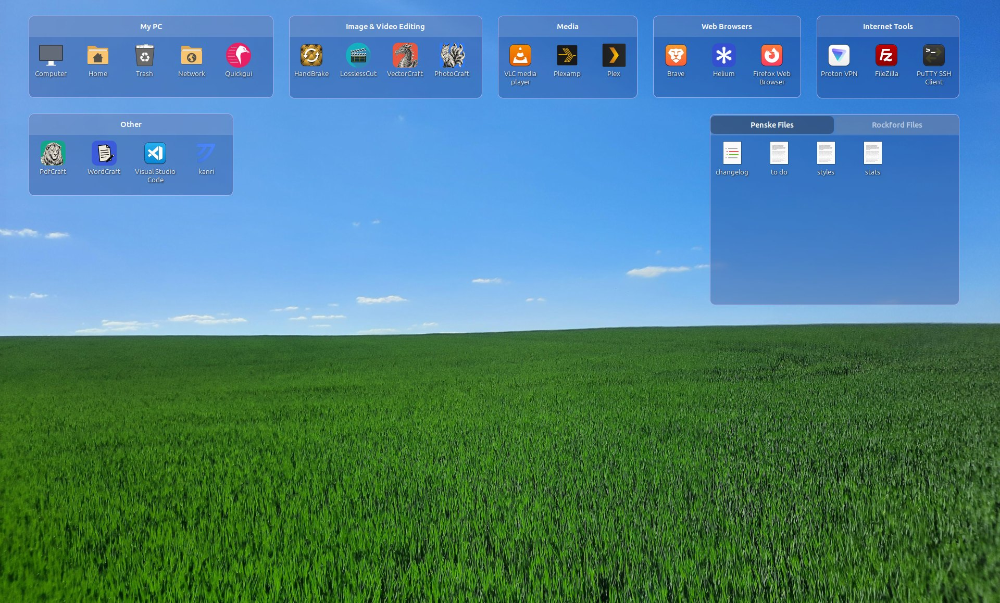
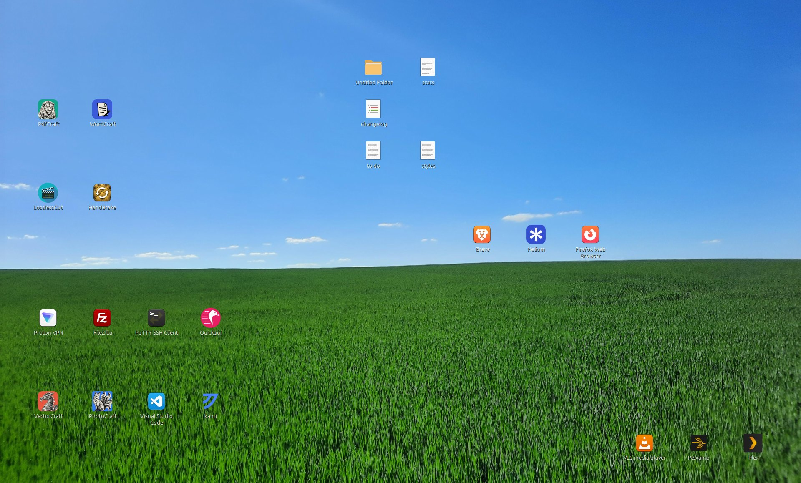
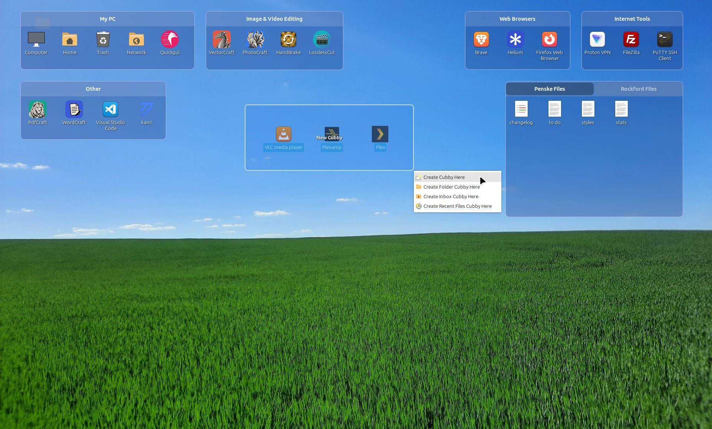
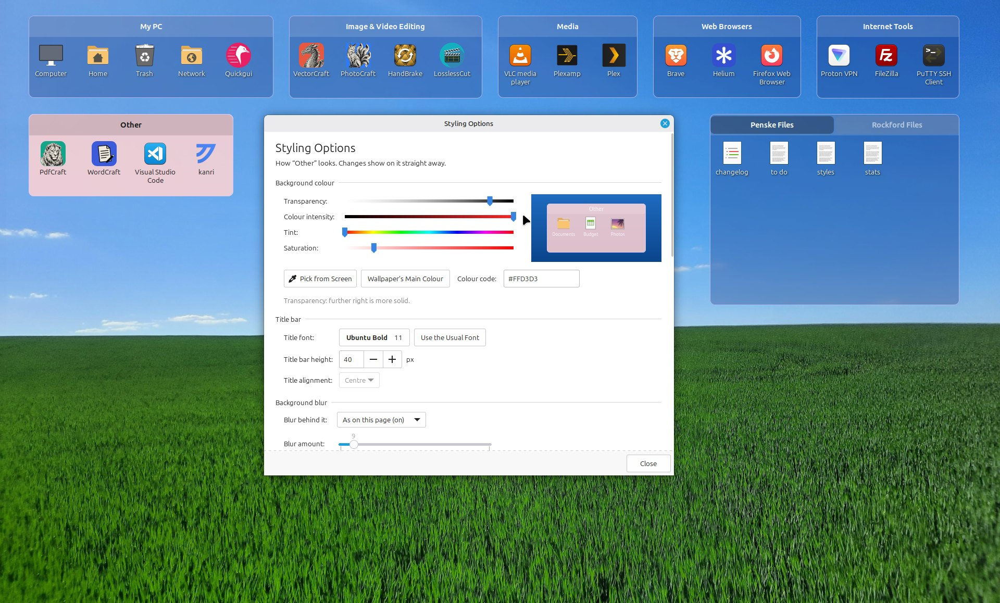
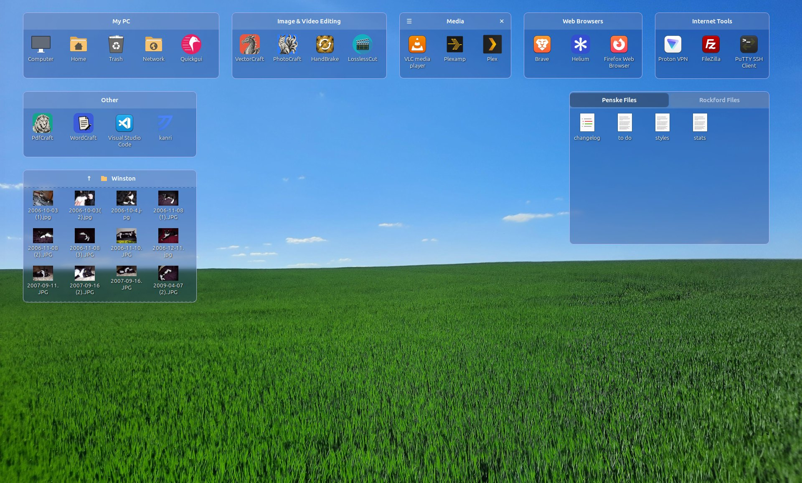
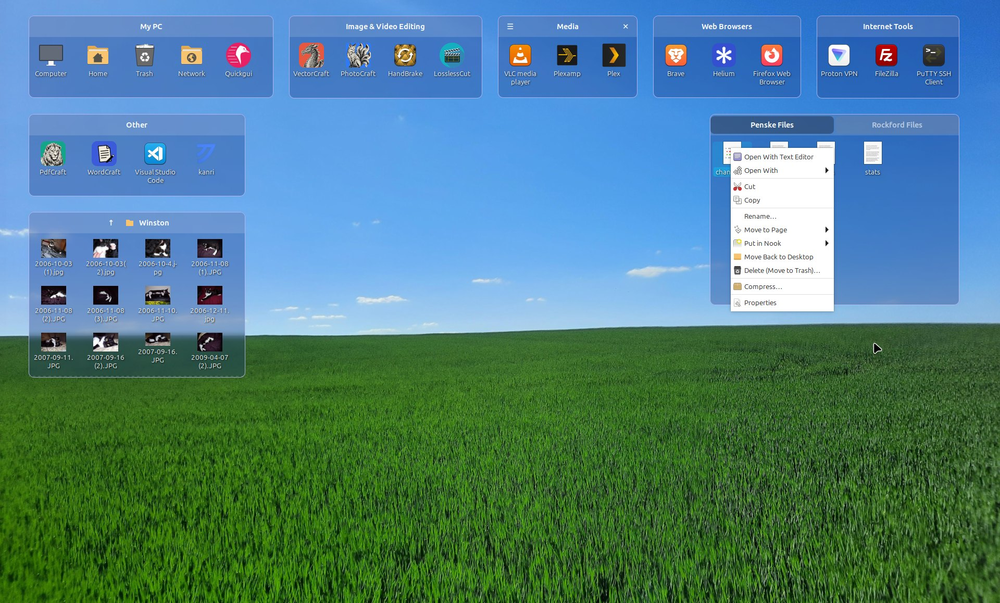
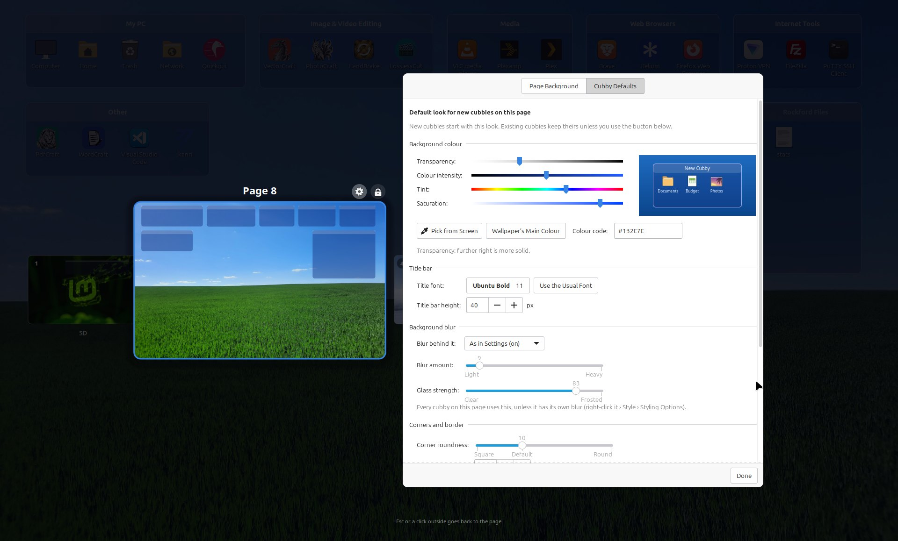
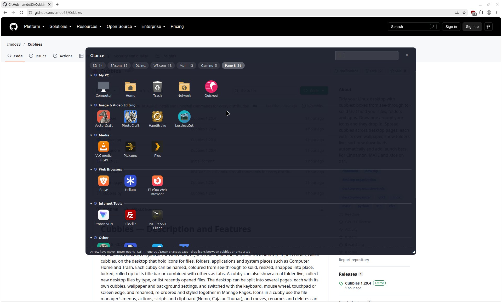
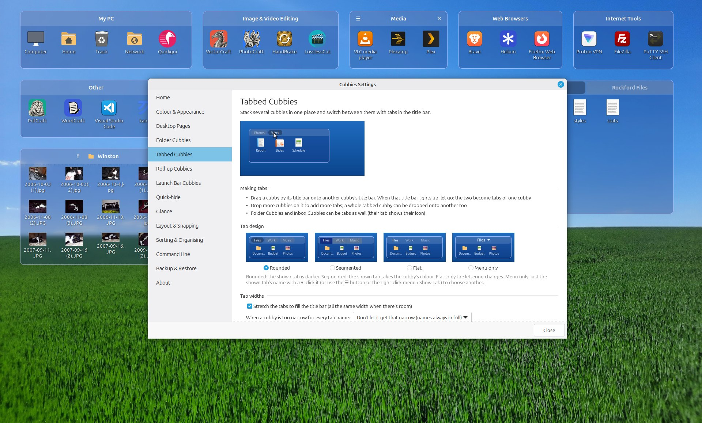

# Cubbies — Description and Features

Oct 18, 2026

Cubbies is a desktop organiser for Linux on X11, with the Cinnamon, MATE or Xfce desktop. It puts boxes, called cubbies, on the desktop that hold icons for files, folders, applications and system places such as Computer, Home and Trash. Each cubby can be named, coloured from see-through to solid, resized, snapped into place, locked, rolled up to its title bar or combined with others as tabs. A cubby can also show a real folder live, collect new desktop files by type, or list recently opened files. The desktop can be split into several pages, each with its own cubbies, wallpaper and background settings, and switched with the keyboard, mouse wheel, touchpad or screen edge, and renamed, re-ordered and styled together in Manage Pages. Icons in a cubby use the file manager's menus, actions, scripts and clipboard (Nemo, Caja or Thunar), and moves, renames and deletes can be undone.



## Highlights

- **Cubbies** — boxes in any colour, from see-through to solid, that hold your files, folders and apps. Draw one on the desktop with the mouse and the icons inside the box drop straight in.
- **Desktop pages** — separate desktops for work, home, games or projects, each with its own cubbies and wallpaper. Turn pages by pulling the edge of the screen, swiping, clicking a dot on the page bar or Ctrl + Left / Right, and rename, re-order and style them all in Manage Pages.
- **Folder Cubbies** — show any real folder live on the desktop, such as Downloads, and browse into sub-folders right inside the box.
- **An Inbox that sorts for you** — new files that land on the desktop go straight into the right cubby by kind: images, documents, music, videos, archives, even plugged-in drives.
- **Tabs, filters and nooks** — stack cubbies as tabs (each with its own colour), filter a cubby by kind of file, or keep hand-picked sets of icons in nooks.
- **Feels like part of your desktop** — on Cinnamon, MATE or Xfce: the same right-click menu, actions and scripts, clipboard and file-conflict prompts as Nemo, Caja or Thunar.
- **Safe with your files** — Undo for moves and deletes, scheduled automatic backups, and a clean uninstall that puts everything back on your Desktop.

## About Cubbies

Cubbies is a free desktop organiser for Linux on X11, with the Cinnamon, MATE or Xfce desktop (tested on Linux Mint, Debian, Ubuntu, Fedora and EndeavourOS), that keeps your desktop tidy with boxes, called cubbies, that hold your icons and can be anything from see-through to solid. It is a Python 3 + GTK3 program, installed from a .deb, .rpm or tar.gz package, and this document describes version 1.20.4.

It is for anyone whose desktop fills up with downloads, documents and shortcuts, and who wants them grouped, labelled and out of the way without giving up the desktop itself.

| Before | After |
| --- | --- |
|  |  |

Three ideas carry the whole program:

- **Cubbies** are boxes on the desktop, as see-through or as solid as you like. Each one holds icons for files, folders and apps, with its own name, colour, size and view. Special kinds show a real folder, catch new downloads, list recent files, or act as a launch bar.
- **Pages** are separate desktops, each with its own cubbies, wallpaper and default look. You turn pages by pulling the screen edge, swiping, scrolling over a title bar, clicking a dot on the page bar, or with Ctrl + Left / Right, and look after them all in Manage Pages.
- **The Cubbies folder** (\~/Cubbies by default) is where files you put in a cubby are kept, so your Desktop folder stays clean. Shortcuts to apps and system places are only linked, never moved.

It works with the desktop rather than replacing it: the desktop's own file manager (Nemo on Cinnamon, Caja on MATE, xfdesktop and Thunar on Xfce) still owns the desktop icons, and Cubbies adds its boxes on top, borrows that file manager's own actions, scripts and clipboard, and asks nothing to be set up first.

## Getting started

Installing takes one command, and Cubbies starts with an empty desktop and a short Welcome Guide, so nothing is rearranged until you choose.

1. Download the file for your distribution from the Releases page:

   | Distribution | File |
   | --- | --- |
   | Linux Mint, LMDE, Debian, Ubuntu | `cubbies_1.20.4_all.deb` |
   | Fedora | `cubbies-1.20.4-1.noarch.rpm` |
   | Arch, EndeavourOS, Manjaro, openSUSE and others | `cubbies-1.20.4.tar.gz` |

2. Install it with a terminal open in the folder you downloaded it to. On Mint, Debian and Ubuntu you can also just double-click the .deb.

   Linux Mint, LMDE, Debian, Ubuntu:
   ```
   sudo apt install ./cubbies_1.20.4_all.deb
   ```
   Fedora:
   ```
   sudo dnf install ./cubbies-1.20.4-1.noarch.rpm
   ```
   Arch, EndeavourOS, Manjaro, openSUSE and others:
   ```
   tar xzf cubbies-1.20.4.tar.gz
   cd cubbies-1.20.4
   sudo ./install.sh
   ```
   install.sh installs what Cubbies needs (with pacman, zypper, dnf or apt), then Cubbies itself.
3. Start **Cubbies** from the app menu (or run `cubbies`). The Welcome Guide opens the first time.
4. Hold the left mouse button on an empty part of the desktop, drag a box, and choose **Create Cubby Here**. Desktop icons inside the box move into it.
5. Drag more files onto it, click its name once more (slowly) to rename it, and right-click it for everything else.
6. To start Cubbies when you log in, tick **Start Cubbies when I log in** in Settings › Home.

Useful first stops: right-click the page bar at the top centre of the screen for New Cubby, New Page and Manage Pages, and Settings › Sorting & Organising to choose where new desktop files go.

## Cubbies and how they look

Every cubby can be placed, sized and styled by hand, and most choices can be set for one cubby or as a page's defaults, and shared with other cubbies and pages.

**Making cubbies**

- Hold the left button on the empty desktop and drag a box, then choose Create Cubby, Folder Cubby or Inbox Cubby Here; desktop icons inside the box go straight into the new cubby.
- Drawing a box around existing cubbies picks them, so they move together.
- Right-click the page bar › New Cubby › Cubby, Folder Cubby, Inbox Cubby, Recent Files Cubby or Launch Bar Cubby.



**Title bars**

- Names are edited in place: a slow second click on the name, or Rename from the menu.
- Hover buttons: ☰ (sort and view) and ✕ (delete) appear at the title corners; while ☰ is there, the right-click menu leaves out Sort By and View to stay short.
- Titles can show always, only on mouseover, or never, in one chosen colour or matched to each cubby.
- Title bar position per cubby: automatic (moves to the bottom near the screen bottom), always top, always bottom, or none at all.
- A padlock shows on locked cubbies; a folder or inbox icon marks special kinds.

**Moving, resizing and snapping**

- Drag the title bar (or the empty space of a cubby with no title bar) to move; drag any side or corner to resize, with matching pointers.
- Snapping to other cubbies, with an exact gap you choose, and to all four screen edges, from a distance you set. Hold Shift to place freely.
- Ctrl + click title bars to pick several cubbies and move them as a group.
- Lock one cubby, every cubby on a page (the padlock in Manage Pages), or Lock All (Settings › Layout & Snapping), so nothing moves by accident.
- Icons sit on a fixed grid: resizing never shifts or re-wraps them; a row or column appears only when a whole icon fits.

**Looks**

- Styling Options per cubby: colour sliders (transparency, intensity, tint, saturation), Pick from Screen, the wallpaper's main colour, a typed colour code, corner roundness, border width, a border colour with the same sliders and tools, title font, height and alignment. The window has a fixed size.
- Share this look: tick the parts to copy (colour, transparency, corners, border, blur, title font, title bar height, alignment, tab font) and the pages to copy them to; unticked parts stay as each cubby has them. Copy and paste a whole style, or use it as the default for a page.
- Page defaults: each page's cubby colour, corners, border, title bar and blur are set from its gear in Manage Pages (Cubby Defaults), and Give Every Cubby on This Page This Look applies them to the cubbies already there.
- Frosted-glass background blur of the wallpaper, switched on in Settings, then set for each page (its Cubby Defaults) and each cubby, with its own blur amount and glass strength; a cubby follows its page's blur until it is given its own.
- See-through cubbies need a compositing window manager; when it is off (possible on MATE and Xfce), Settings › Colour & Appearance says where to turn it on.
- Idle fading: cubbies fade when the pointer isn't over them, to a level you choose.
- Roll-up: double-click a title bar to roll a cubby up to its title; it opens on hover, on click, or not at all. Cubbies docked at the top or bottom edge can roll up by themselves.



## Kinds of cubbies, tabs and filters

A cubby can be one of five kinds; Right-click › Cubby Type switches between the first four.

| Kind | What it holds | Notable behaviour |
| --- | --- | --- |
| Regular Cubby | Files, folders and app shortcuts you add | Files are kept in the Cubbies folder; shortcuts are linked |
| Folder Cubby | A real folder, shown live (up to 400 items) | Double-click a sub-folder to look inside it, ↑ to go back; drops move files into the folder and ask on name clashes; network folders are checked every 3 seconds |
| Inbox Cubby | New files that land on the desktop | Catches “everything else”; has its own icon |
| Recent Files Cubby | The files you opened lately, newest first | Fills itself; Clear Recent Files from its menu |
| Launch Bar Cubby | Your favourite apps, along a screen edge | No title bar, auto-hide, one click to open; see Pages and launch bars |



**Tabbed cubbies**

- Drag one title bar onto another to combine cubbies as tabs. Dragging a tab moves the whole tabbed cubby; Ctrl + drag slides the tab to a new place in the row (the others move aside as you go) or pulls it out as a cubby of its own, with a faint copy of the tab following the pointer along the row and a live preview once it is pulled out. A setting swaps the two.
- Each tab has its own ☰ and ✕ on hover, can be renamed in place, and takes files dropped straight onto it. Each tab can have its own colour; while it is shown, the cubby takes that colour. The Tab Colour window lists the other tabs' colours to reuse in one click, and can give every tab the same colour.
- Four tab designs: rounded, segmented, flat, or a drop-down list; a per-cubby tab font. Tabs stretch to fill the title bar at equal widths and always show their full names; a cubby too narrow for them stops at the width they need, or (by choice) the tabs scroll with ‹ › arrows or shorten their names.

**Filter tabs and nooks**

- Any cubby can show filter tabs under its title bar: All plus Images, Documents, Music, Videos, Archives, Folders, Drives and Other.
- Your own tabs by file type (for example “Scripts” for py, sh, js).
- Nooks: tabs that hold the icons you pick yourself; drag icons onto the nook's tab, or right-click icons › Put in Nook.
- The Filter Tabs window shows a live preview of the tabs, how many of the cubby's files each kind holds, and matching-file counts for your own tabs.
- Search in a cubby with Ctrl + F (or from its menu): a search strip slides down and filters the icons as you type.

## Files and icons

Icons in a cubby behave like icons in the file manager: same menus, same clipboard, same apps.

**Adding**

- Drag and drop from the file manager (Nemo, Caja or Thunar), the desktop or another cubby; or right-click › Add Files, Add Folder, Add Applications.
- Add System Places: Computer, Home Folder, Trash, Network, Recent and each mounted drive; the menu stays open so you can tick several in one go. Dragging these in from the file manager or the desktop works too, as do network shares. Taken from the desktop (dragged in, or drawn around), the desktop's own Computer, Home, Trash and Network icons (File System, Home and Trash on Xfce) are switched off there and come back when no cubby holds them. Home, drives and these shortcuts can be renamed inside Cubbies without changing anything on disk; Home is called Home rather than your user name, and on Xfce Computer is called File System.
- The Trash icon shows full or empty, has Empty Trash…, lights up while files are dragged over it, and files dropped on it go to the Trash. Dragging a Trash, Computer or Network shortcut out of a cubby onto the desktop gives the desktop its own icon back.
- Create New Folder and Create New Document (Empty Document or your templates) open straight into renaming.

**Views and selection**

- Icons, List or Details (with clickable column headings); icon size from 24 to 256 px by slider, presets or Ctrl + wheel; names can be hidden.
- Scroll bars per cubby: Vertical, Horizontal (icons fill the rows and scroll sideways) or Both (a fixed number of columns).
- Thumbnails for pictures and documents (animated GIFs move), read from the system's thumbnail cache or made in the background.
- Sort by name, type, date or size, or arrange by hand; Ctrl + click, Shift + click and rubber-band selection; Delete and F2 work while the pointer is over the cubby.
- Open with a double-click, or one click (everywhere, or only in launch bars).
- Hovering a folder icon shows a quick preview of what's inside.

**The file menu** (right-click an icon), laid out like the file manager's

- Open, Open With (your apps for that type), Cut, Copy, Rename, Move to Page, Delete or Remove from Cubby, Move Back to Desktop, Show in Folder, Properties.
- Your own file-manager actions and scripts: Nemo actions and scripts on Cinnamon, Caja scripts and caja-actions on MATE, Thunar custom actions on Xfce; plus Compress and Extract Here (File Roller or Engrampa).
- Cut / Copy / Paste work both ways with the file manager (Nemo, Caja and Thunar).



**Safety**

- Name clashes in a Folder Cubby open a conflict window like the file manager's: both files' preview, size and date, Cancel, Skip, Keep Both or Rename, Replace (the old file goes to the Trash), or Merge for folders, with “do the same for the others”.
- Files on network shares or drives without a Trash ask before being deleted for good.
- Undo (Ctrl + Z over a cubby, or Undo in the menus) takes back moves, deletes, renames and layout changes, restoring files from the Trash.

## Pages, launch bars, hiding and collecting

**Pages**

- Each page has its own cubbies, default look, wallpaper (picked from the desktop's wallpaper sets and your own folders), picture aspect (or No picture, for just the colour) and background colour or gradient, which the blur and the pictures in Manage Pages follow, all set from the page's gear in Manage Pages. Pages can be turned off altogether.
- Turn pages by pulling the left or right screen edge (the cubbies slide like a page, with an optional bounce), a sideways touchpad swipe, the mouse wheel over a title bar or the page bar, Ctrl + Left / Right (or Super + Ctrl), or the command line. The page keys are only taken while the desktop is in front, so other programs keep them (a setting can change that).
- Drag a cubby to the screen edge and hold it to carry it to the next page; a new page is made if there isn't one, and empty pages made that way are removed again.
- Show on Every Page keeps a cubby on all pages, in its own place on each page or the same place everywhere; deleting it lists the pages it is on first.
- Ctrl + Up shows every page as a small picture with its wallpaper and cubbies: click one, press its number, or use the arrow keys and Enter. Many pages wrap onto more rows so all stay in view.
- Manage Pages (page bar menu, a double-click on the page name, Ctrl + Super + M from any window, or cubbies --manage-pages) shows the same pictures: drag them into a new order, or click one to bring it forward and Rename, Delete or Go to Page. Its padlock locks every cubby on the page, a click on a cubby in the picture locks just that one, and its gear opens the page's settings beside it: Page Background and Cubby Defaults.



**The page bar**

- Shows the page name and a dot for each page: click a dot to go to that page, point at one to see its name, or double-click the name for Manage Pages. Its right-click menu has Undo (when there is something to undo), New Page, Manage Pages, Page Bar Position, New Cubby, Settings and Quit.
- Shows when the pointer rests at its edge, always, or only with a key (Ctrl + Alt + P or Ctrl + Super + P, or `cubbies --page-bar`).
- Sits at the top centre, the bottom centre, or anywhere you drag it.

**Launch Bar Cubbies**

- A row of apps along the top or bottom edge with no title bar, made from Settings or the page bar; full width or just as wide as its icons, with its own icon size and names on or off.
- Choose which pages use which launch bar: one for every page, one per page, or any grouping (four of ten pages can share one).
- It stays on its edge: if a screen resize, a panel or a drag pushes it off, it goes back within a second.
- Auto-hide: it slides, fades or vanishes, leaving a thin strip; it comes out when the pointer rests at the edge or when you click there, and goes away when the pointer leaves or when you click elsewhere. The corners stay free for window buttons, and it comes out over your windows.
- An optional line along its inner edge: thickness, colour, and solid, dashed, dotted, dash-dot or double.
- The page bar tucks just under it: under the hidden strip while the bar is hidden, and out of the way while the bar is out.

**Quick-hide and Glance**

- Quick-hide: double-click the empty desktop (or `cubbies --toggle`) to hide every cubby, optionally the desktop icons too; chosen cubbies can stay visible.
- Glance: Super + Space (or another key) opens a panel over your windows with a tab for every page and a Favourites row of what you open most. Click an icon to open it, drag it into an app or onto another cubby (even on another page), type to find anything on any page, or use the arrow keys and Enter. Groups fold away, the panel can be moved and resized, and a hot corner can open it. Your cubbies stay where they are on the desktop.



**Collecting new desktop files**

- New files that land on the desktop are moved into the cubby that collects their kind: images, documents, music, videos, archives, folders or everything else.
- Mounted drives (USB, discs, network shares) go into the cubby that collects drives and leave again when unplugged.
- Per page: a file goes to the collecting cubby on the page you were on, and pages without their own choice can use another page's (so one Inbox can serve most pages).

## Settings, backups, command line and installing

**Settings window**

- Sections down the side: Home, Colour & Appearance, Desktop Pages, Folder Cubbies, Tabbed Cubbies, Roll-up Cubbies, Launch Bar Cubbies, Quick-hide, Glance, Layout & Snapping, Sorting & Organising, Command Line, Backup & Restore, About.
- Drawn previews (some animated) show what each choice does; scrolling the page never changes a setting by accident.
- A Welcome Guide of ten short topics opens on first start and from Settings › Home.



**Backups and layouts**

- Settings › Backup & Restore: Back Up Now, Save a Copy As… (another drive, a USB stick, the cloud) and Restore from a File…, plus a list of recent backups (when, what kind, how many pages and cubbies) with Restore and Delete on each.
- Automatic backups: never (the default), each time Cubbies starts, every day or every week, keeping the newest 3 to 200 (20 unless you change it). One is skipped when nothing has changed since the last, and cubbies --backup makes one for your own schedule.
- Restoring an older backup never loses files: anything in the Cubbies folder that no restored cubby holds goes back to the Desktop.
- Saved layouts: remember where every cubby is under a name and put them back later.
- When a screen is unplugged, its cubbies move onto a remaining screen and go back when it returns.
- F5 on the desktop refreshes every cubby.

**Command line** (also usable for your own keyboard shortcuts)

| Area | Commands |
| --- | --- |
| Showing | `--toggle` `--hide` `--show` `--glance` `--manage-pages` `--refresh` |
| Pages | `--next-page` `--prev-page` `--page NUMBER\|NAME` `--list` `--page-bar` |
| Cubbies | `--new-cubby [TITLE]` `--new-launch-bar` `--add-folder FOLDER…` `--lock-all` `--unlock-all` |
| Layouts | `--save-layout` `--restore-layout` `--list-layouts` `--delete-layout` |
| Backups | `--backup [FILE]` `--restore FILE` |
| The program | `--settings` `--restart` `--quit` `--install-autostart` `--remove-autostart` `--version` `--help` |

**Installing, updating and removing**

- A .deb package for Mint, Debian and Ubuntu, an .rpm for Fedora, and a tar.gz with an install script (sudo ./install.sh) for other distributions such as Arch; start it from the app menu (“Cubbies”) or with `cubbies`. Start at login is a checkbox in Settings › Home.
- Installing a new version restarts a running copy by itself; replacing the program file also restarts it within seconds.
- “Show as a Folder Cubby on the Desktop” is added to folder menus: a Nemo action on Cinnamon, a Caja action on MATE (with caja-actions installed), and Send To › Folder Cubby on the Desktop in Thunar.
- Uninstalling puts everything back: the wallpaper and background settings, the desktop's Computer, Home, Trash and Network icons, your files (moved back to the Desktop) and the file manager's desktop settings, on every desktop Cubbies has run on; the configuration and autostart entry are removed.
- To uninstall: `sudo apt remove cubbies` (Mint, Debian, Ubuntu), `sudo dnf remove cubbies` (Fedora), or `sudo ./install.sh --uninstall` from the unpacked tar.gz folder (others).
- Needs Linux on X11 with Cinnamon, MATE or Xfce (tested on Linux Mint, Debian, Ubuntu, Fedora and EndeavourOS), Python 3, PyGObject with its cairo bindings, GTK 3 and libX11; libwnck is recommended. Wayland is not supported.

## FAQ

**Does Cubbies move my files?** Only the ones you put in a cubby, and only if you want it to. By default they are moved into \~/Cubbies so your Desktop folder stays clean; you can turn that off, or move the Cubbies folder anywhere, in Settings › Sorting & Organising. App shortcuts, system places, drives and anything outside your home folder are only linked, never moved. Folder Cubbies show a folder where it is.

**What happens if I uninstall it?** Everything goes back: the files it stored are moved back to your Desktop, your wallpaper and desktop-icon settings are restored (on Cinnamon, MATE and Xfce alike), and its configuration and autostart entry are removed.

**Does it replace the desktop or the file manager?** No. Nemo, Caja or xfdesktop still draws the desktop and its icons; Cubbies adds its boxes on top. The desktop's own right-click menu is unchanged, so Cubbies adds its commands to the page bar, its own menus, and a folder action in the file manager.

**Does it work on Wayland, or on other desktops?** It is built for Linux on X11 with Cinnamon, MATE or Xfce, and has been tested on Linux Mint, Debian, Ubuntu, Fedora and EndeavourOS. Other X11 desktops would need some changes (wallpaper, desktop icons, file manager), and Wayland is not supported.

**Can I control it from the keyboard or my own shortcuts?** Yes. Ctrl + Left / Right turns pages and Ctrl + Up shows them all (while the desktop is in front, so other programs keep those keys), Ctrl + Super + M opens Manage Pages from any window, Super + Space opens the Glance panel, Ctrl + Z undoes and Ctrl + F searches over a cubby, and every command in the command-line table can be bound to a key in System Settings › Keyboard › Shortcuts (Cinnamon), Control Center › Keyboard Shortcuts (MATE) or Settings Manager › Keyboard › Application Shortcuts (Xfce).

**Is it heavy?** It is one Python program with no background services. It watches the pointer in short, light polls to notice desktop clicks, edge pulls and the launch bar, and makes thumbnails in the background.

**Will my layout survive a monitor change?** Yes. Cubbies left on an unplugged screen move onto one that's still there and go back when it returns, and saved layouts let you switch arrangements by name.

## Feedback and contributing

Cubbies is free, and bug reports and feature requests are welcome on the GitHub Issues page.

- When reporting a bug, include your Cubbies version (`cubbies --version`), your distribution and desktop (Cinnamon, MATE or Xfce), and if you can, the output of running it with debug messages on: `CUBBIES_DEBUG=1 cubbies`.
- Pull requests are turned off. If you have a fix or a translation, open an issue and describe it there. The source is a Python package split by area (cubbies/cubby/ for the boxes, cubbies/app/ for the rest), and sh packaging/build.sh builds the .deb, .rpm and tar.gz.
